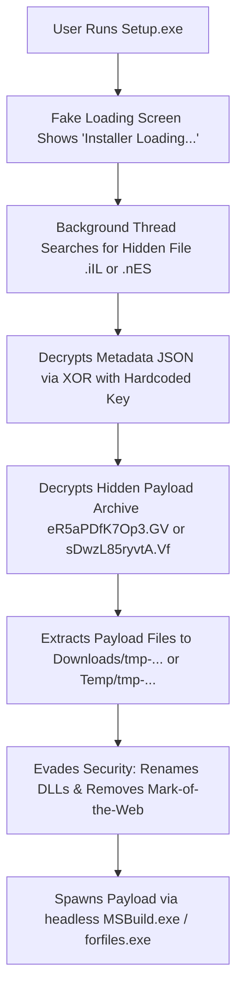

# SaaS E-commerce & Security Analysis - Restored History Report

This document compiles and restores the complete history of your past conversations and analysis regarding SaaS E-commerce, security warnings, and architecture modifications. Because of your PC restart, this context has been automatically retrieved from the Antigravity system logs and restored here for your reference.

---

## 📁 Overview of Restored Conversations

We recovered detailed reports and file changes spanning two major conversation threads:

1. **Malware & Security Analysis (Conv: `775d986f-3995-4a45-9ffb-fd9b8af415e7`)**
   - Detailed breakdown of local source code archives under `D:\SaaS_Sorce_Code\SaaS`.
   - Security warning explaining how the hidden Ren'Py Trojan loaders bypass Windows SmartScreen/Antivirus.
   - Analysis of `https://admin.bdeshio.com/` (Angular Single-Page App, powered by SaleEcom).
2. **Admin Panel SPA Upgrade & Custom Multi-Vendor Package (Conv: `694e3e0d-3425-43ad-8063-60da22c0ae56`)**
   - The conversion of **TLCommerce** (`C:\laragon\www\tlcommerce`) from Laravel Blade (MPA) to **Inertia.js + Vue 3 (SPA)** to match Bdeshio’s speed.
   - Development of a free, custom **Multi-Vendor Marketplace** package (`Outlets\Marketplace`) for Bagisto v2.4.6 (`C:\laragon\www\bdoutlets`).

---

## 🛡️ 1. Security Analysis of Local Source Codes (`D:\SaaS_Sorce_Code\SaaS`)

During the analysis of your local directories, a critical security issue was discovered. All four downloaded source code archives were found to be **malicious Trojan droppers** with zero actual e-commerce code:
- `Download_Commerce_SaaS_Nulled_rar_Archive_free_6474.zip`
- `Download_Commerce_SaaS_Nulled_rar_Archive_win_9531.zip`
- `Download_Store_Mart_SaaS_Nulled_rar_Archive_free_716638.zip`
- `Download_Store_SaaS_Nulled_rar_Archive_win_747197.zip`

### ⚙️ How the Ren'Py Trojan Operates Under the Hood

1. **Decoy Progress Bar:** Running `Setup.exe` starts a Ren'Py game engine executable showing an "Installer Loading..." progress bar to keep you waiting.
2. **Decryption of Hidden Files:** The app finds hidden files in the `data/` folder (like `.iIL` or `.nES`) containing Base64 metadata and decrypts them using a hardcoded XOR key (`81034149cd6f48c8821340204f92766e`).
3. **Payload Extraction:** It uses the password found in the metadata to decrypt the main payload (`eR5aPDfK7Op3.GV` or `sDwzL85ryvtA.Vf`), which is actually a ZIP containing malicious DLLs and a command script (`f22qFE1h2.cmd`).
4. **Antivirus Evasion (LOLBINs):** It writes a Zone Identifier to remove "Mark-of-the-Web" (bypassing SmartScreen), renames DLL extensions to random names, and runs the script using `forfiles.exe` to break the parent-child process tree monitoring.
5. **MSBuild Compilation:** It runs a hidden 9.3 MB MSBuild file (`CustomerPortal.csproj`) to compile/execute malicious code silently.

> [!CAUTION]
> **IMMEDIATE ACTION REQUIRED:** If you executed `Setup.exe` on your local PC:
> 1. Disconnect your PC from the network immediately.
> 2. Search your task manager and running processes for `forfiles.exe` or background MSBuild sessions.
> 3. Scan your PC with a reliable, updated scanner (like Windows Defender Offline or Malwarebytes).
> 4. Change all passwords from a separate, secure device.

---

## ⚡ 2. TLCommerce SPA (Inertia.js + Vue 3) Upgrade (`C:\laragon\www\tlcommerce`)

Your goal was to replicate the **zero-loading/instant-transition** feel of the Bdeshio admin panel (`https://admin.bdeshio.com/`). Because Bdeshio is an SPA built in Angular, clicking on its menu swaps components on the client-side, whereas TLCommerce (Laravel Blade MPA) reloaded the page on every single click.

To achieve this without a full backend rewrite, we implemented **Inertia.js + Vue 3**:

- **Inertia.js Integration:** Enabled Inertia routing on the Laravel backend.
- **Middleware Registered:** Added `HandleInertiaRequests` middleware to `Kernel.php` to pass shared data (flash messages, auth states).
- **Assets Configured:** Swapped the root layout to [app.blade.php](file:///C:/laragon/www/tlcommerce/resources/views/app.blade.php), created [admin.js](file:///C:/laragon/www/tlcommerce/resources/js/admin.js) and [admin.scss](file:///C:/laragon/www/tlcommerce/resources/sass/admin.scss), and compiled via `Laravel Mix` into `/public/backend/assets/js/admin-spa.js`.
- **Pages Converted to Vue Components:**
  - `AdminLayout.vue` (Side navigation bar with matching active states and collapse micro-animations).
  - `Dashboard.vue` (Dashboard layout with stats cards matching Bdeshio’s look).
  - `Settings.vue` (Grid cards style layouts for system parameters).
- **Controllers Updated:** Updated `DashboardController` and `GeneralSettingsController` to import `Inertia` and render pages client-side using `Inertia::render()`.

### 🧪 Local Testing Credentials (Restored)
- **Login URL:** `http://127.0.0.1:8000/admin/login`
- **Email:** `admin@tlcommerce.test`
- **Password:** `123456`

---

## 🛍️ 3. Bagisto Multi-Vendor Marketplace Package (`C:\laragon\www\bdoutlets`)

For the Bagisto v2.4.6 project, we created a custom, free **Multi-Vendor Marketplace package** inside `packages/Outlets/Marketplace/`:
- **[MarketplaceServiceProvider.php](file:///C:/laragon/www/bdoutlets/packages/Outlets/Marketplace/src/Providers/MarketplaceServiceProvider.php):** Registers namespaces, views, custom middleware, and migrations.
- **[routes.php](file:///C:/laragon/www/bdoutlets/packages/Outlets/Marketplace/src/Http/routes.php):** Sets up routes for seller onboarding, seller dashboard metrics, product catalogs, and admin moderations.
- **[RedirectIfNotSeller.php](file:///C:/laragon/www/bdoutlets/packages/Outlets/Marketplace/src/Http/Middleware/RedirectIfNotSeller.php):** Blocks access to the partner dashboard if the customer's seller status is not "approved".
- **Models & Controllers:** Added database mapping and controllers for onboarding requests, product curation (linked to Bagisto Flat indexer), sales calculations, and commissions.

---

### 💡 Restore Scripts Reference (In Scratch Folder)
If you need to review the Python decryption or extraction scripts we used, they have been preserved in your scratch folder:
- **XOR Decryption:** [decrypt_meta.py](file:///c:/Users/arraa/.gemini/antigravity-ide/scratch/decrypt_meta.py) / [decrypt_meta_dynamic.py](file:///c:/Users/arraa/.gemini/antigravity-ide/scratch/decrypt_meta_dynamic.py)
- **ZIP Extraction:** [decrypt_payload.py](file:///c:/Users/arraa/.gemini/antigravity-ide/scratch/decrypt_payload.py) / [extract_rpa.py](file:///c:/Users/arraa/.gemini/antigravity-ide/scratch/extract_rpa.py)
- **Restored Raw Notes:** [research_notes_restored.md](file:///c:/Users/arraa/.gemini/antigravity-ide/scratch/research_notes_restored.md)

---

Please review this information. You can check the code files or run the local servers to verify. Let me know when you are ready to proceed with other topics!
